# Rozdělování pomocníků — návod krok za krokem

Tento návod tě provede celým postupem: od stažení programu a nahrání odpovědí
organizátorů a pomocníků až po hotovou tabulku v Excelu. Je psaný jednoduše
a skoro každý krok má obrázek.

**Jak číst obrázky.** Na obrázcích je **červeným rámečkem** označeno, na co
máš kliknout nebo na co se máš podívat. Je-li rámečků víc, mají **čísla** —
ta odpovídají číslům v textu pod obrázkem.

> Všechna jména, e-maily a telefony na obrázcích jsou **vymyšlená**. Žádný
> obrázek nepochází ze skutečných dat.

## Obsah

1. [Než začneš](#1-než-začneš)
2. [Instalace a spuštění](#2-instalace-a-spuštění)
3. [Jak vypadá aplikace](#3-jak-vypadá-aplikace)
4. [Krok 1: Nahraj organizátory](#4-krok-1-nahraj-organizátory)
5. [Krok 2: Nahraj pomocníky](#5-krok-2-nahraj-pomocníky)
6. [Krok 3: Přiřaď jména kamarádů](#6-krok-3-přiřaď-jména-kamarádů)
7. [Krok 4: Načti budovy a místnosti](#7-krok-4-načti-budovy-a-místnosti)
8. [Krok 5: Štítky (nepovinné)](#8-krok-5-štítky-nepovinné)
9. [Krok 6: Vynucené skupinky kamarádů (nepovinné)](#9-krok-6-vynucené-skupinky-kamarádů-nepovinné)
10. [Krok 7: Parametry rozřazování (nepovinné)](#10-krok-7-parametry-rozřazování-nepovinné)
11. [Krok 8: Sestav rozdělení](#11-krok-8-sestav-rozdělení)
12. [Krok 9: Uprav rozdělení ručně](#12-krok-9-uprav-rozdělení-ručně)
13. [Krok 10: Ulož verzi a exportuj do Excelu](#13-krok-10-ulož-verzi-a-exportuj-do-excelu)
14. [Když něco nejde](#14-když-něco-nejde)

---

## 1. Než začneš

Připrav si tři soubory. **Nahrávají se v tomhle pořadí** — důvod je u každého
kroku, stručně: tabulka budov jmenuje organizátory, takže ti už musí být
v programu, a kamarádem pomocníka může být i organizátor.

1. **Odpovědi organizátorů** — soubor `.xlsx` s odpověďmi z Google Formuláře
   pro organizátory, stažený jako Excel. Nic v něm neupravuj.
2. **Odpovědi pomocníků** — stejně stažený soubor `.xlsx` z formuláře pro
   pomocníky. Také nic neupravuj.
3. **Tabulka budov „Pomocníci v místnostech“** — soubor `.xlsx`, ve kterém je
   nakreslené, jaké budovy a místnosti jsou, kolik lidí která role potřebuje
   a kdo je vedoucí. Jak má vypadat, ukazuje [krok 4](#7-krok-4-načti-budovy-a-místnosti).
   Pomocníci ani organizátoři ji nevyplňují, připravuješ ji ty (nebo ji máš
   z minulého ročníku).

Vše, co v programu uděláš, se **ukládá samo**. Nemusíš nic ukládat na konci práce.

**Prohlížeč.** Aplikace běží v prohlížeči. Používej **Chrome, Edge nebo
Firefox**. V **Safari** aplikace nefunguje správně, proto ji v něm
nepoužívej. (Na Macu si nainstaluj jiný prohlížeč a adresu z [části 2](#2-instalace-a-spuštění)
do něj zkopíruj ručně, protože program otevírá ten výchozí.)

## 2. Instalace a spuštění

Nepotřebuješ Python ani žádný jiný program. Stačí stáhnout verzi pro svůj
systém, rozbalit ji a spustit.

### Stažení

1. Otevři stránku s vydáními:
   <https://github.com/Krtiiik/MaSo-Rostering/releases/latest>. Je tam vždy
   nejnovější verze.
2. Sjeď dolů k seznamu příloh (**Assets**) a stáhni jeden soubor podle svého
   systému. Ostatní přílohy a položky *Source code* nepotřebuješ.

   | Systém | Soubor |
   |---|---|
   | Windows | `rostering-vX.Y.Z-windows-x64.zip` |
   | macOS (Apple silicon: M1 a novější) | `rostering-vX.Y.Z-macos-arm64.tar.gz` |
   | Linux | `rostering-vX.Y.Z-linux-x64.tar.gz` |

   `X.Y.Z` je číslo verze. Mac s procesorem Intel program nepodporuje.
3. **Než soubor rozbalíš, přečti si [potíže se spuštěním](#potíže-se-spuštěním--udělej-to-hned)
   níž.** Windows a macOS stažené programy blokují. Pár kroků hned na začátku
   ti ušetří hledání, proč se nic nespustí.

### Rozbalení a spuštění

Archiv rozbal do složky, kde ti bude vyhovovat (třeba `Dokumenty`). Vznikne
složka `rostering`; **všechno v ní nech pohromadě**.

- **Windows:** archiv rozbal **celý** (pravý klik, *Extrahovat vše*). Program
  nespouštěj přímo z okna se zipem, nefunguje to. Pak ve složce `rostering`
  dvakrát klikni na `rostering.exe`.
- **macOS a Linux:** otevři terminál, přejdi do složky a spusť program. Pro
  složku `rostering` ve stažených souborech:

  ```bash
  cd ~/Downloads/rostering
  ./rostering
  ```

Po chvíli se otevře prohlížeč s aplikací na adrese <http://127.0.0.1:8000>.
**Okno programu nech při práci otevřené** — když ho zavřeš, aplikace přestane
fungovat. Skončit můžeš zavřením tohoto okna (v terminálu klávesami Ctrl+C).

### Potíže se spuštěním — udělej to hned

Program není digitálně podepsaný a stahuje se z internetu, takže ho systém
považuje za nedůvěryhodný. Na Windows i na macOS proto stačí pár kroků, aby se
nic neblokovalo. Udělej je rovnou po stažení, ještě než program poprvé spustíš.

#### Windows

Windows si u souborů z internetu pamatuje, že jsou „z internetu“, a rozbalené
soubory tu značku dědí. Pak je buď zablokuje, nebo ukáže varování.

1. **Před rozbalením:** na stažený `.zip` klikni pravým tlačítkem, vyber
   *Vlastnosti* a dole na kartě *Obecné* zaškrtni **Odblokovat** (v angličtině
   *Unblock*). Potvrď *OK*. Teprve potom soubor rozbal.
2. Při prvním spuštění se může objevit modré okno **Windows ochránil váš
   počítač**. Klikni na **Další informace** a pak na **Přesto spustit**.
3. Nechce-li se ti odblokovávat zip, nebo už jsi ho rozbalil(a), odblokuj
   rozbalenou složku v PowerShellu (cesta je ukázka, dosaď svou):

   ```powershell
   Get-ChildItem -Recurse "$HOME\Downloads\rostering" | Unblock-File
   ```

   Nastavení **politiky spouštění skriptů** (*ExecutionPolicy*) měnit
   nemusíš. Ta se týká skriptů `.ps1`, ne programu `rostering.exe`, a příkaz
   výše ji nepotřebuje.
4. Smaže-li program antivirus nebo ho označí za podezřelý, obnov ho
   z karantény a přidej složku `rostering` mezi výjimky. Program běží jen na
   tvém počítači a nikam nic neposílá.

#### macOS

macOS stažený program označí jako „z internetu“ (*karanténa*) a program bez
podpisu odmítne spustit. Po rozbalení archivu (dvojklik na `.tar.gz`) otevři
**Terminál** (klávesy Cmd+Mezerník, napiš *Terminál*, Enter) a zadej dva
příkazy. Cestu uprav, pokud jsi složku `rostering` rozbalil(a) jinam než do
`Downloads`:

```bash
xattr -cr ~/Downloads/rostering
codesign --force --deep --sign - ~/Downloads/rostering
```

První příkaz z programu smaže značku „staženo z internetu“, druhý ho
podepíše přímo na tvém Macu (bez účtu u Applu), aby ho systém nechal
spustit. Tyhle dva příkazy pomohly na Macu, kde macOS program zablokoval.
Pak program spusť, jak je popsáno výš:

```bash
cd ~/Downloads/rostering
./rostering
```

Ukáže-li macOS přesto hlášku o neověřeném vývojáři, otevři *Nastavení systému*,
*Soukromí a zabezpečení* a dole u zablokovaného programu klikni na
**Přesto otevřít**.

#### Linux

Obvykle není co řešit. Hlásí-li systém *Permission denied*, program označ jako
spustitelný: `chmod +x rostering`.

### Aktualizace a data

Všechna data jsou ve složce `data`, která vznikne ve složce, odkud program
spouštíš (u Windows tedy ve složce `rostering`). Jsou v ní osobní údaje
skutečných pomocníků, **nesdílej je ani nezveřejňuj**. Při přechodu na novou
verzi zkopíruj složku `data` vedle nové verze programu. Celý ročník můžeš
přenést i na jiný počítač tlačítky *Exportovat* a *Importovat* v postranním
panelu.

## 3. Jak vypadá aplikace

Nahoře je **šest záložek**. Jdou za sebou tak, jak se pracuje:

| Záložka | K čemu slouží |
|---|---|
| **1. Lidé** | organizátoři a pomocníci |
| **2. Budovy** | budovy, místnosti, počty lidí a vedoucí |
| **3. Štítky** | označování lidí a pravidla pro ně (nepovinné) |
| **4. Vynucené skupinky kamarádů** | kdo musí být spolu (nepovinné) |
| **5. Parametry rozřazování** | jak moc počítač váží přání (nepovinné) |
| **6. Rozdělení pomocníků** | výsledek, ruční úpravy a export |

Budovy jsou před štítky a skupinkami schválně: pravidla štítků a skupinek
vybírají budovy a místnosti z toho, co už máš zadané.

Vlevo je **postranní panel**. Otevřeš ho nebo zavřeš tlačítkem ☰ vlevo nahoře.

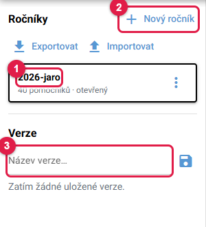

1. **Ročník** — jedna soutěž (například `2026-jaro`). Každý ročník má svá
   vlastní data. Mezi ročníky se přepíná tlačítkem *Otevřít* u ročníku.
2. **Nový ročník** — založí prázdný ročník.
3. **Verze** — pojmenované „zálohy“ rozdělení. Viz [krok 10](#13-krok-10-ulož-verzi-a-exportuj-do-excelu).

Vpravo nahoře je ikona se zaškrtávátky. Otevře panel **K vyřízení**: seznam
všeho, co čeká na tvoje rozhodnutí. Číslo na ikoně říká, kolik toho je.
Když je číslo nenulové, stojí za to se tam podívat.

## 4. Krok 1: Nahraj organizátory

Na záložce **1. Lidé** je prázdná aplikace. Klikni na **Načíst organizátory**
a vyber soubor s jejich odpověďmi. **Organizátory nahrávej jako první**:
tabulka budov v kroku 4 se na ně odkazuje jménem a kamarádem pomocníka může
být i organizátor, takže ho aplikace u pomocníků pozná jen tehdy, když už je
nahraný.

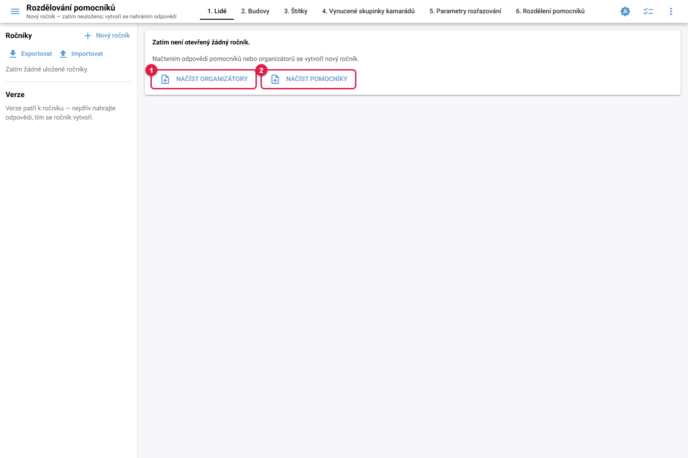

1. **Načíst organizátory** — nejdřív tohle.
2. **Načíst pomocníky** — až potom.

Aplikace se zeptá na **označení ročníku**. Soubor organizátorů neobsahuje data
odeslání, takže ho **napiš sám(sama)**. Tvar je *rok-jaro* nebo *rok-podzim*,
například `2026-jaro` (jaro je leden až červen, podzim červenec až prosinec).
Pak klikni na **Vytvořit ročník a načíst odpovědi**.

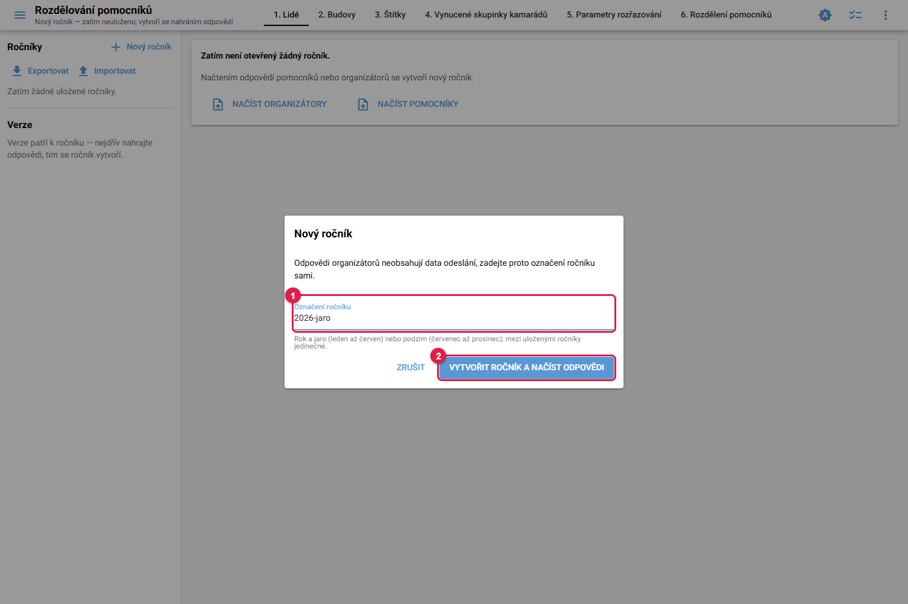

1. Označení ročníku.
2. Tlačítko, které ročník vytvoří a načte odpovědi.

Hotovo — v tabulce **Organizátoři** vidíš všechny, kdo se přihlásili. Organizátor,
který na formuláři odpověděl, že v den soutěže nepřijde, má jméno přeškrtnuté
a zaškrtnuté políčko *Nemůže se zúčastnit* (na obrázku je to Tereza Pospíšilová).

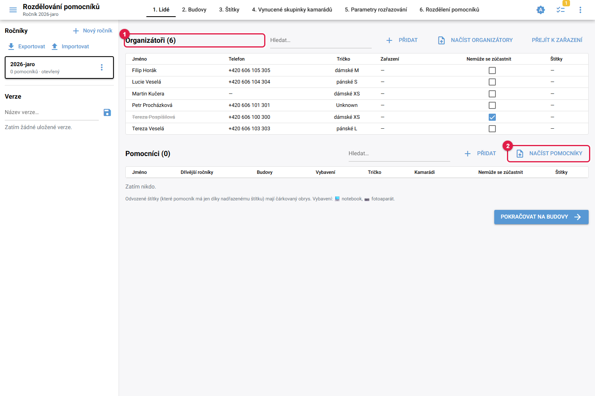

1. Tabulka **Organizátoři** s počtem načtených lidí.
2. **Načíst pomocníky** — další krok.

Dobré vědět:

- Organizátoři **nejsou** rozdělováni počítačem. Na místa vedoucích je dosadí
  tabulka budov v [kroku 4](#7-krok-4-načti-budovy-a-místnosti), případně je
  postavíš ručně v [kroku 9](#12-krok-9-uprav-rozdělení-ručně).
- Přišly novější odpovědi? Klikni znovu na **Načíst organizátory** a vyber
  novější soubor. Aplikace lidi pozná podle e-mailu (nebo jména), doplní nové
  a nic ruční nezmění.
- Někdo chybí? Tlačítkem **Přidat** nad tabulkou ho zadáš ručně.

## 5. Krok 2: Nahraj pomocníky

Teď klikni na **Načíst pomocníky** (v hlavičce tabulky **Pomocníci**) a vyber
soubor s odpověďmi pomocníků. Tady se už na označení ročníku nikdo neptá,
ročník existuje.

V tabulce **Pomocníci** vidíš všechny, kdo se přihlásili. U každého je vidět,
v jakých budovách chce pomáhat, jaké může přinést vybavení (notebook,
fotoaparát), velikost trička a kolik kamarádů uvedl.

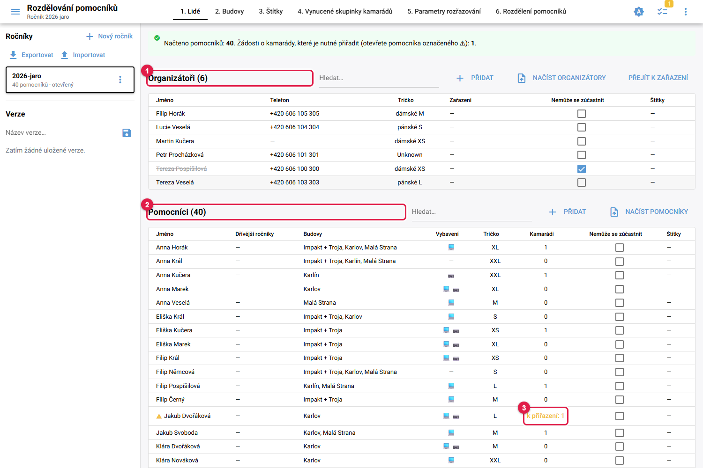

1. Tabulka **Organizátoři**, jak ji znáš z minulého kroku.
2. Tabulka **Pomocníci** s počtem načtených lidí.
3. Oranžové **k přiřazení** — viz další krok.

Dobré vědět:

- Kdo se nakonec **nemůže zúčastnit**, tomu zaškrtni políčko
  *Nemůže se zúčastnit* v jeho řádku. Do rozdělení se pak nedostane.
- Přihlásil se někdo pozdě? Klikni na **Přidat** nad tabulkou a zadej
  ho ručně (jméno a kontakt). Ukážeme to v [kroku 9](#12-krok-9-uprav-rozdělení-ručně).
- Přišly nové odpovědi? Klikni znovu na **Načíst pomocníky** a vyber
  novější soubor. Nic se tím nesmaže — aplikace jen doplní nové lidi
  a v panelu **K vyřízení** ukáže, co se změnilo.
- Má soubor pomocníků list **GChD** (studenti školy GCHD a jejich třídy),
  aplikace podle něj sama vytvoří štítky `GCHD` a štítky tříd. K nim se dostaneš
  v [kroku 5](#8-krok-5-štítky-nepovinné).

## 6. Krok 3: Přiřaď jména kamarádů

Pomocníci píší jména kamarádů volným textem („Terka“, „Kolega z fakulty“).
Aplikace většinu jmen pozná sama, včetně těch, která patří organizátorům.
Na ta, která nepozná, se zeptá.

Poznáš je podle ⚠ u jména a oranžového textu **k přiřazení** ve sloupci
*Kamarádi*. Klikni na něj.

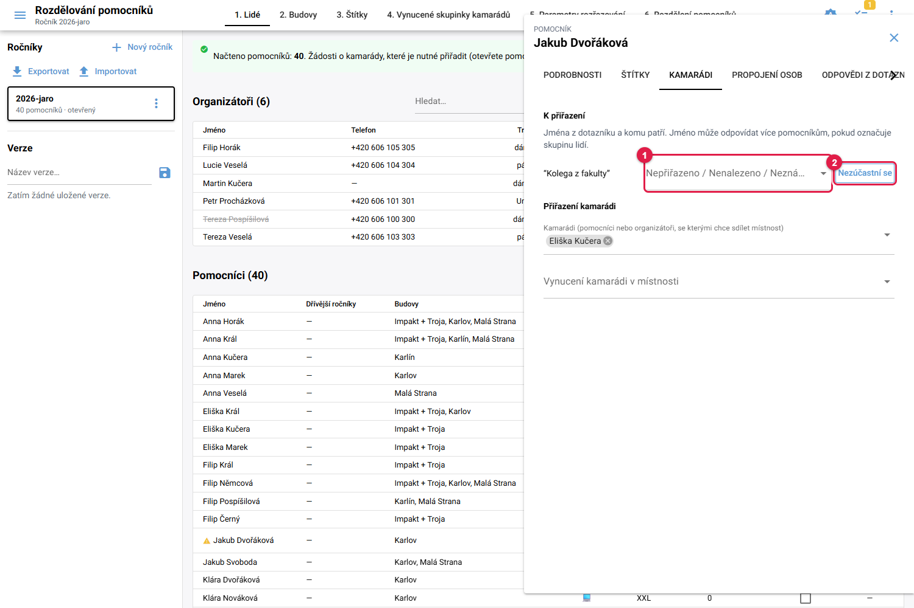

Otevře se okno pomocníka na kartě **Kamarádi**. V části **K přiřazení** uvidíš
napsané jméno v uvozovkách.

1. Ze seznamu vyber správného člověka. Je-li jméno nesmysl nebo neznámé,
   nech ho tak, jak je.
2. Je-li to člověk, který se soutěže **nezúčastní**, klikni na
   **Nezúčastní se**. Přání se pak nebude brát v úvahu.

Okno zavři křížkem vpravo nahoře. Změny se ukládají samy.

## 7. Krok 4: Načti budovy a místnosti

Počítač potřebuje vědět, **kde se pomáhá a kolik lidí je třeba**. Otevři
záložku **2. Budovy** (nebo klikni na **Pokračovat na budovy** dole na záložce Lidé).

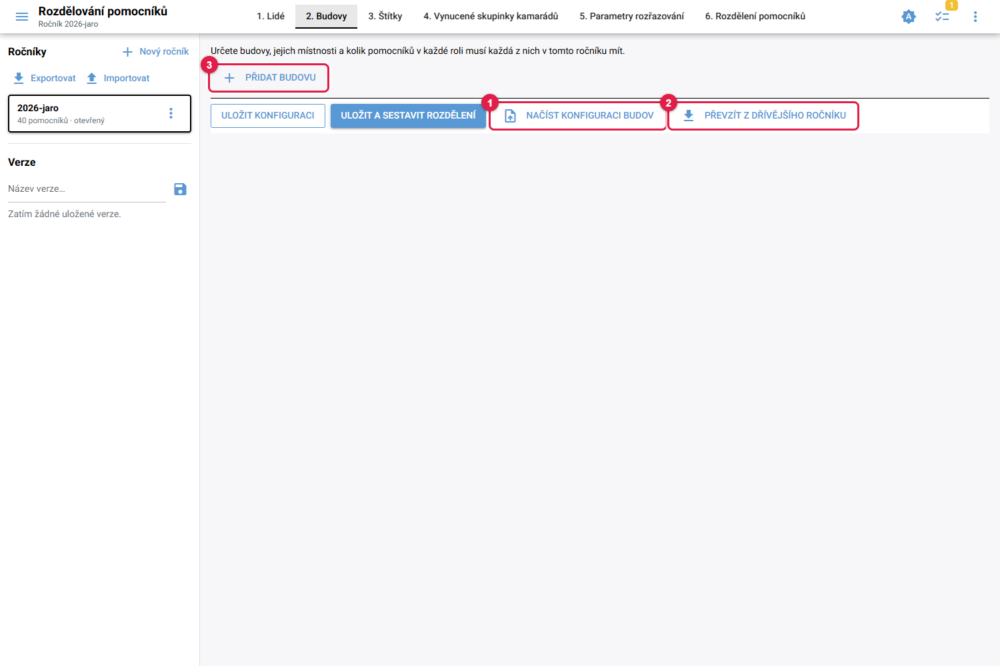

Budovy zadáš třemi způsoby. **Doporučený je ten první**, tabulka budov:

1. **Načíst konfiguraci budov** — načte tabulku „Pomocníci v místnostech“.
   Je nejrychlejší a jako jediná zároveň **dosadí organizátory** na místa
   vedoucích.
2. **Převzít z dřívějšího ročníku** — zkopíruje budovy a počty z minulého
   ročníku.
3. **Přidat budovu** — ruční zadání, vysvětlené [níž](#úprava-budov-ručně).

### Tabulka budov „Pomocníci v místnostech“

Tabulka je obyčejný soubor `.xlsx` a **čte se z ní podle barev, sloučených
buněk a jmen**, ne podle čísel nebo textu. Takhle vypadá:

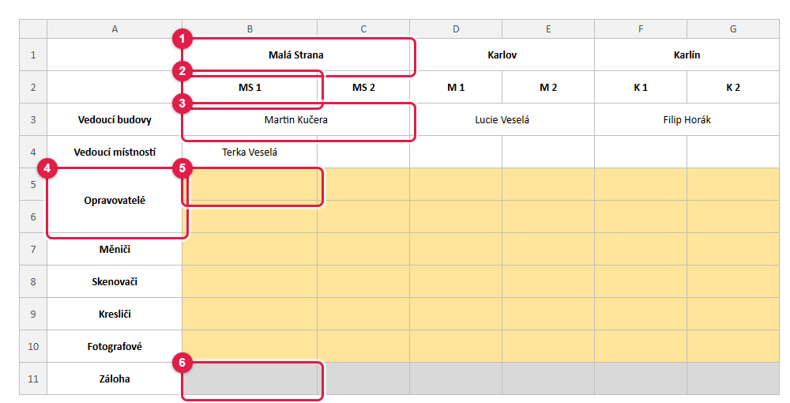

1. **Budovy** jsou v horním řádku, každá jako sloučená buňka přes své místnosti.
2. **Místnosti** jsou v řádku pod nimi. Velká místnost může zabírat dva sloupce
   (sloučená buňka nebo prázdná buňka vedle).
3. **Vedoucí budovy**, **Pravá ruka**, **Vedoucí místností** a **Technická
   podpora** mají v buňkách **jména organizátorů** (víc jmen v jedné buňce
   odděl čárkou). Jména se hledají mezi organizátory z kroku 1 a nezáleží
   na velikosti písmen ani na diakritice.
4. První sloupec říká, **která role** to je. Přečte se podle začátku názvu:
   *Opravovatelé*, *Měniči*, *Skenovači*, *Kresliči*, *Fotografové*, *Záloha*.
   Role může mít víc řádků (sloučená buňka).
5. **Barevná buňka** pod místností znamená **jednoho potřebného pomocníka**.
6. **Šedá, bílá nebo prázdná buňka** znamená, že tam nikdo není potřeba.

Další pravidla, ať tabulka vyjde napoprvé:

- Čte se jeden list souboru (ten, který byl při uložení otevřený, obvykle
  první). Nad prvním popsaným řádkem musí být dva řádky záhlaví: budovy
  a pod nimi místnosti.
- Buňka sloučená přes víc místností (typicky Fotografové) se počítá **jednou**
  za celou budovu.
- Text a čísla v barevných buňkách se **nečtou**. Rozhoduje jen to, zda je
  buňka barevná.
- Řádky *Focení předávání cen*, *Uvaděči účastníků* a *Registrace* se pro počty
  nečtou. Přenesou se ale sloučené buňky z řádků místností i buňky sloučené
  přes dvě role.
- Je-li organizátor uveden na víc místech, platí poslední z nich.
  Organizátor, který nemůže přijít, se přeskočí (aplikace to napíše).

Teď tabulku načti:

1. Na záložce **2. Budovy** klikni na **Načíst konfiguraci budov** a vyber
   soubor.
2. Rozložení se **uloží hned**. Objeví se zpráva, kolik budov, místností
   a zařazení organizátorů se načetlo, případně upozornění na to, co se
   nepodařilo přečíst.
3. Má-li ročník už zadané vedoucí nebo sloučené buňky, které by tabulka
   **nahradila**, aplikace se předem zeptá („Nahradit vedoucí a sloučené
   buňky?“). Potvrď, nebo zruš a nic se nezmění.

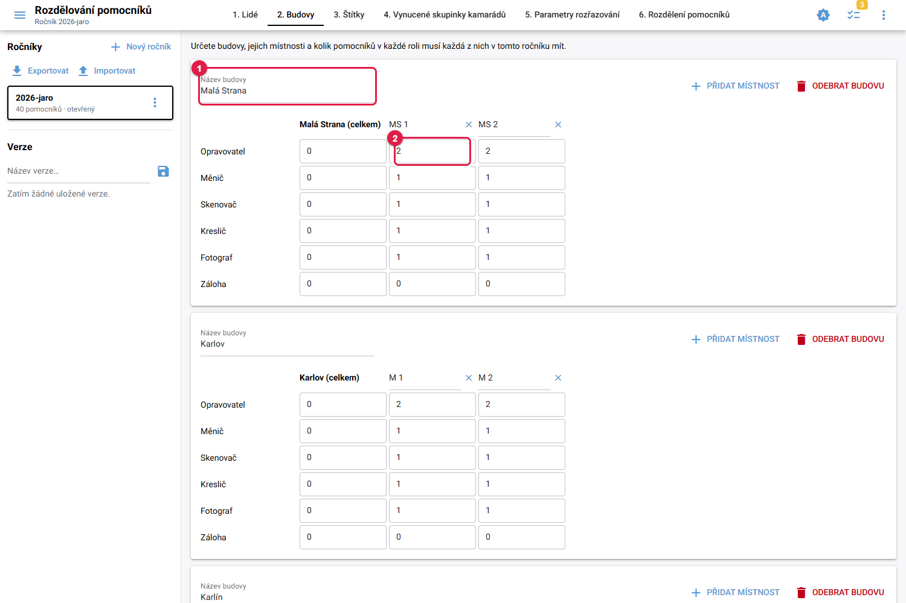

1. Název budovy, jak byl v tabulce.
2. Počet pomocníků v roli a místnosti, spočítaný z barevných buněk.

Zkontroluj, že počty sedí. Chybí-li něco, oprav to v tabulce a načti ji znovu,
nebo to uprav ručně přímo tady.

#### Jména z tabulky bez shody

Je-li v tabulce jméno, které není mezi organizátory přesně tak, jak je
napsané, ozve se aplikace v panelu **K vyřízení** (ikona se zaškrtávátky
vpravo nahoře). Nic se neztratí, jen čeká na tvoje rozhodnutí.

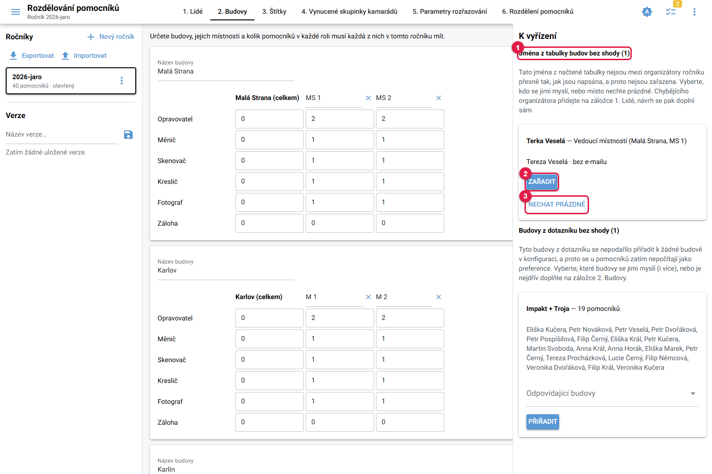

1. Nadpis **Jména z tabulky budov bez shody** — kolik takových jmen je.
2. **Zařadit** — organizátor, který se nejvíc podobá (třeba „Terka Veselá“
   a „Tereza Veselá“), se dosadí na to místo.
3. **Nechat prázdné** — místo zůstane volné. Organizátora můžeš dosadit
   později ručně.

Chybí-li organizátor v seznamu úplně, přidej ho na záložce **1. Lidé**
(tlačítko **Přidat** nad tabulkou *Organizátoři*); návrh se pak doplní sám.

#### Budovy z dotazníku bez shody

Pomocníci vybírali budovy ve formuláři. Pokud nějaká budova z formuláře nemá
u tebe odpovídající budovu, ozve se aplikace v panelu **K vyřízení** i tady.

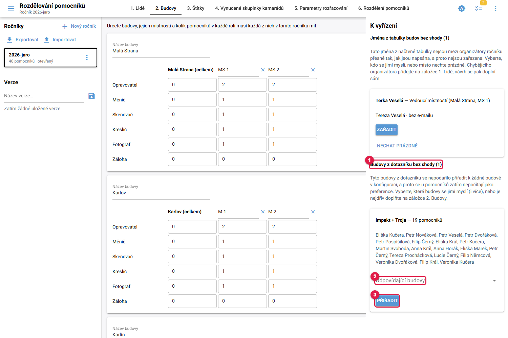

1. Nadpis **Budovy z dotazníku bez shody** — kolik takových názvů je.
2. **Odpovídající budovy** — vyber, kterým tvým budovám tento název odpovídá.
3. **Přiřadit** — potvrdí.

Nebo se vrať na záložku **2. Budovy** a chybějící budovu přidej. V této
ukázce jsme budovu „Impakt + Troja“ v tabulce nechali záměrně, aby bylo vidět,
jak se aplikace ptá. Dokud ji nepřiřadíš, nepočítá se u těchto
pomocníků budova jako jejich přání.

### Převzetí z dřívějšího ročníku

Tlačítko **Převzít z dřívějšího ročníku** otevře nabídku importu. Část
*Rozložení budov* zkopíruje budovy, místnosti, počty i sloučené buňky z vybraného
ročníku (ne obsazení vedoucích, ta přijdou z tabulky). Hodí se, když se rozložení
od minula skoro nezměnilo. Stejná nabídka umí převzít i štítky a vynucené
skupinky ([krok 5](#8-krok-5-štítky-nepovinné) a [krok 6](#9-krok-6-vynucené-skupinky-kamarádů-nepovinné)).

### Úprava budov ručně

Cokoli z načtených budov můžeš kdykoli upravit, nebo budovy zadat celé ručně.
Zapomněl(a) jsi budovu v tabulce? Klikni na **Přidat budovu** — jednou za každou
budovu.

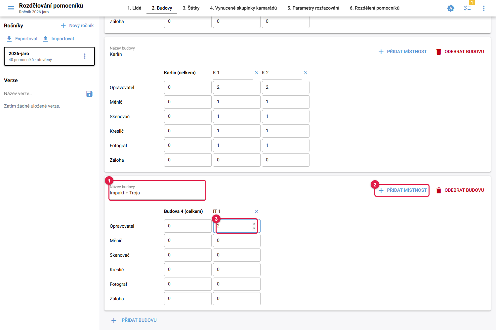

1. Napiš **název budovy**. Piš ho tak, jak ho psali pomocníci
   (například `Karlov`), aby ho aplikace poznala.
2. Klikni na **Přidat místnost** a přidej všechny místnosti. Jejich
   názvy přepíšeš přímo v záhlaví tabulky.
3. Do tabulky napiš, **kolik lidí v jaké roli** musí být v místnosti
   (například 2 opravovatelé, 1 měnič…). Sloupec *celkem* je pro počty
   za celou budovu, když nezáleží na místnosti.

Až máš vše vyplněné, klikni dole na **Uložit konfiguraci**.

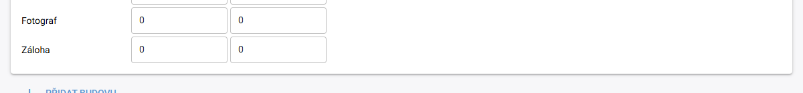

1. **Uložit konfiguraci** — uloží budovy, nic dalšího se nestane.
2. **Uložit a sestavit rozdělení** — uloží a rovnou spustí výpočet ([krok 8](#11-krok-8-sestav-rozdělení)).

Žlutá nálepka **Neuložené změny** znamená, že jsi ještě neuložil(a). Načtení
tabulky se ukládá samo, ruční úpravy ale ne.

## 8. Krok 5: Štítky (nepovinné)

Tuhle záložku můžeš **přeskočit**. Hodí se, až budeš chtít, aby se někdo
řídil zvláštním pravidlem (třeba „žáci 8.M patří do Karlova“).

**Štítek** je poznámka u člověka (pomocníka i organizátora), například „8.M“.
Ke štítku lze přidat **pravidla**, která platí pro každého, kdo ho nese.

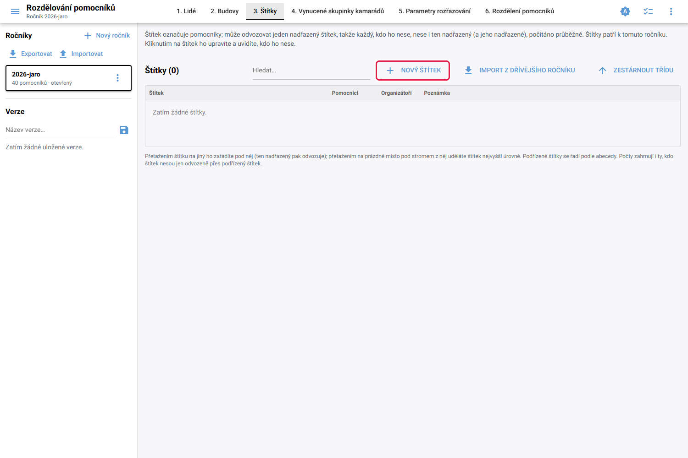

### Nadřazený štítek

Štítek může **odvozovat jeden nadřazený štítek**. Kdo nese „8.M“, nese tak
i „GCHD“, aniž by ho musel dostat zvlášť. Takové odvozené štítky mají u lidí
**čárkovaný obrys**. Pravidla nadřazeného štítku se dědí: **kdo nese podřízený
štítek, dodržuje i pravidla nadřazeného**. Opačně to neplatí. Štítek má nejvýš
jeden nadřazený štítek a nemůže odvozovat sám sebe ani svůj podřízený štítek.
Odvozené štítky počítá aplikace za chodu, nikam se nekopírují.

Nadřazený štítek vybereš při vytváření (*Odvozuje (nadřazený štítek)*) nebo
později **přetažením štítku** na jiný ve stromu štítků. Přetažením na prázdné
místo pod stromem z něj uděláš štítek nejvyšší úrovně.

### Vytvoření štítku a jeho pravidla

1. Klikni na **Nový štítek**. Vpravo se otevře panel štítku.
2. Napiš **název** (jedinečný). Můžeš vybrat barvu, poznámku a nadřazený štítek.
3. V části **Pravidla: kdo štítek nese** klikni na **Přidat pravidlo** a vyber,
   co má pravidlo říkat. Pak klikni na **Vytvořit štítek**.

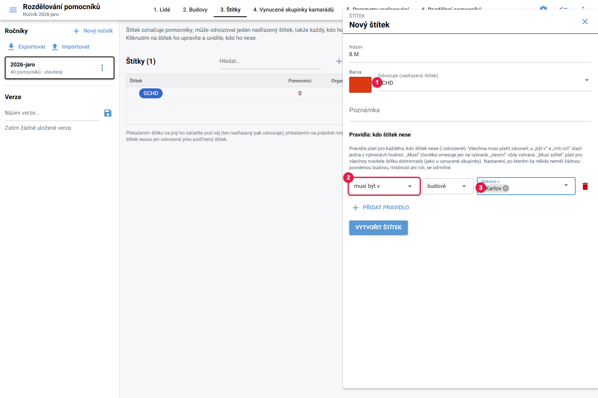

1. Nadřazený štítek (zde `GCHD`).
2. Druh pravidla (zde *musí být v*) a čeho se týká (budova nebo místnost).
3. Vybrané hodnoty. Zde tedy platí: nositel štítku 8.M musí být v budově Karlov.

K dispozici je pět druhů pravidel:

| Pravidlo | Co říká |
|---|---|
| **musí být v** budově / místnosti | nositel smí být jen v některé z vybraných budov (místností) |
| **nesmí být v** budově / místnosti | nositel nesmí být v žádné z vybraných budov (místností) |
| **musí mít roli** | nositel musí dostat některou z vybraných rolí |
| **nesmí mít roli** | nositel nesmí dostat žádnou z vybraných rolí |
| **musí sdílet** budovu / místnost / roli | **všichni nositelé štítku** musí být ve stejné budově / místnosti / roli |

Jak se pravidla skládají:

- **Všechna pravidla štítku platí zároveň.**
- U *musí být v* a *musí mít roli* **stačí jedna z vybraných hodnot**.
- Je-li víc pravidel „musí“, nositel musí splnit všechna. Pravidlo „nesmí“
  **vždy vyhrává**: co zakazuje, to je zakázané, i kdyby to jiné pravidlo
  povolovalo.
- Místnost je povolená jen tehdy, když je povolená i její budova.
- *Musí sdílet* potřebuje aspoň dva nositele. Chová se jako vynucená skupinka
  ([krok 6](#9-krok-6-vynucené-skupinky-kamarádů-nepovinné)) všech, kdo štítek
  nesou, včetně organizátorů.
- **Organizátor** nemá roli, takže se posuzuje jen podle budovy (a místnosti,
  jestli nějakou má).
- Pravidlo, které jmenuje budovu nebo místnost, kterou tento ročník nemá,
  se **ignoruje** a u pravidla je oranžové upozornění.
- Nastavení, po kterém by někdo neměl **žádnou** povolenou budovu, místnost ani
  roli, aplikace **odmítne** a řekne proč.

### Tvrdé a měkké pravidlo

Každé pravidlo je buď **tvrdé** (výchozí), nebo **měkké**. Přepíná se
**zámečkem** vlevo od pravidla: zavřený zámek (modrý) je tvrdé pravidlo,
otevřený (šedý) měkké. Funguje stejně u štítků i u vynucených skupinek.

- **Tvrdé pravidlo** se dodrží vždy, když to nějak jde. Poruší se až
  v nouzi (viz níže) a rozdělení, které by ho porušilo, ti aplikace nenabídne
  jen proto, že je „o trochu lepší“.
- **Měkké pravidlo** se počítači **jen doporučuje**. Porušení má cenu, kterou
  počítač váží proti přáním budovy, kamarádů a rolí. Když je jinak výsledek
  výrazně lepší, měkké pravidlo klidně poruší. Jak moc „měkké“ je, nastavíš
  na záložce **5. Parametry rozřazování** v poli **Váha porušeného měkkého
  pravidla** (výchozí 2, tedy méně než přání budovy nebo kamaráda).
- Porušené měkké pravidlo se mezi **porušenými pravidly** objeví také, jen je
  šedé a u pravidla stojí **(měkké)**. Tlačítko s počtem je oranžové, pokud
  jsou porušená jen měkká pravidla.
- Měkké pravidlo **nikdy nic neodmítne**: nevadí, že by si s jiným pravidlem
  odporovalo, ani že by člověku nenechalo žádnou povolenou budovu.

### Komu štítek dát

Štítek přiřadíš dvěma způsoby:

- Ve štítku, v části **Kdo štítek nese**: zaškrtni lidi a klikni na
  **Uložit změny**. Kdo ho nese jen odvozeně (přes podřízený štítek), je
  označen „přes …“ a políčko má prázdné.
- U člověka na záložce **1. Lidé**: klikni na jeho řádek a v kartě otevři
  záložku **Štítky**.

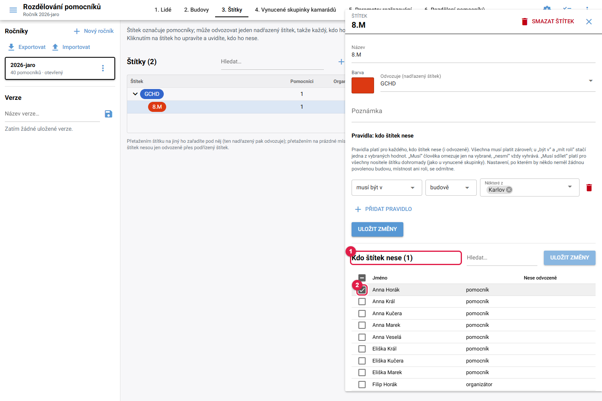

1. Počet lidí, kteří štítek nesou.
2. Zaškrtnutý člověk — ten štítek nese přímo.

Štítky (strom se štítky a počtem lidí u nich) pak vypadají takto:

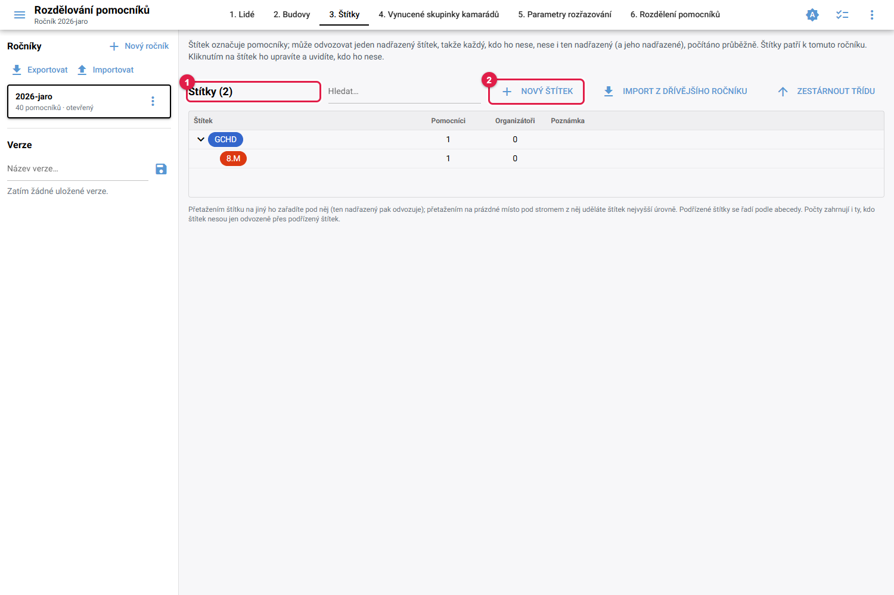

### Co se stane, když se pravidlo nedá splnit

Tvrdá pravidla štítků se počítač snaží dodržet za každou cenu (měkká jen
doporučují, viz [Tvrdé a měkké pravidlo](#tvrdé-a-měkké-pravidlo)). Když se
nedají splnit všechna najednou, rozdělení **přesto vytvoří** a to, co porušil, ukáže
jako **porušené pravidlo** (červené tlačítko na záložce
**6. Rozdělení pomocníků**; tlačítko **Opravit** tě zavede ke štítku).
Napřed „obětuje“ počty lidí v místnostech, potom pravidla štítků, potom
skupinky a nakonec vybavení (fotoaparát pro Fotografa). Ruční přesun na jiné
místo **nikdy nezakáže**, jen se v rozdělení ukáže jako porušení. Změna pravidel
se do rozdělení promítne až při příštím sestavení, porušení se ale ukáže hned.

Dobré vědět: štítky patří vždy **jednomu ročníku**. Do nového ročníku je převezmeš
nabídkou **Import z dřívějšího ročníku** (i s pravidly a se štítky přenesenými
na vracející se pomocníky); u žáků se tam hodí **Zestárnout třídu**, která
přejmenuje „8.M“ na „9.M“.

## 9. Krok 6: Vynucené skupinky kamarádů (nepovinné)

Tuhle záložku můžeš také **přeskočit**. **Vynucená skupinka** je pár nebo
skupina lidí, na které platí seznam pravidel, třeba „budou **určitě** spolu
v jedné místnosti“. Na rozdíl od *přání být s kamarádem*, které pomocník napsal
do formuláře a které se jen **zkusí** splnit, je skupinka **pravidlo**, které
se hlídá.

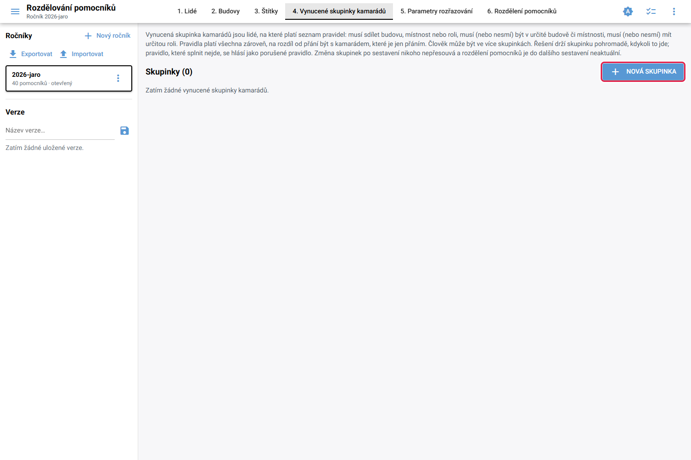

Skupinku vytvoříš tlačítkem **Nová skupinka**:

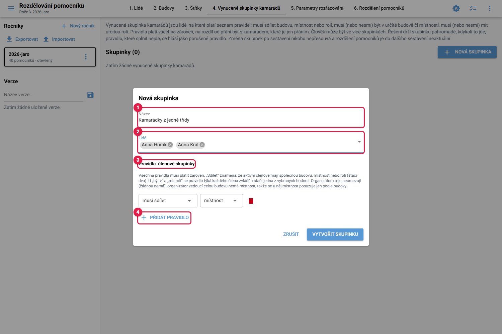

1. **Název** skupinky.
2. **Lidé** — kdo do ní patří. Může to být pomocník i organizátor a stejný
   člověk může být ve více skupinkách.
3. **Pravidla** — co všechno musí platit. Jsou stejná jako u štítků: *musí
   sdílet* budovu / místnost / roli, *musí být v*, *nesmí být v*, *musí mít roli*
   a *nesmí mít roli*. Další přidáš tlačítkem **Přidat pravidlo**. Zámeček
   vlevo od pravidla ho přepíná mezi **tvrdým** a **měkkým**
   (viz [Tvrdé a měkké pravidlo](#tvrdé-a-měkké-pravidlo)).
4. **Vytvořit skupinku** dole.

Hotová skupinka je na záložce vidět jako karta:

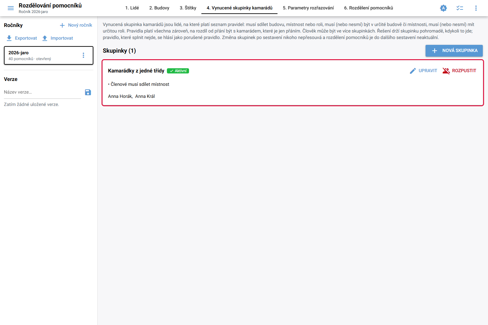

Pravidla skupinek:

- **Všechna pravidla skupinky platí zároveň.** *Musí sdílet* je splněno, když
  mají **aktivní členové** společnou budovu, místnost nebo roli (stačí dva).
  Pravidla *být v* a *mít roli* se týkají **každého člena zvlášť** a stačí
  jedna z vybraných hodnot. Skupinka jednoho člověka s pravidlem *musí být v*
  tak může člověka „připnout“ na místo.
- Skupinka má **stav**: **Aktivní**, **Nečinná** (žádné její pravidlo zatím nic
  nevyžaduje, důvod je vypsaný pod pravidly) nebo **Porušena** (aktuální
  rozdělení pravidlo nesplňuje).
- Člen, který **nemůže přijít**, zůstane ve skupince, ale je neaktivní (je
  to u něj napsané). Člen, který se letos **nepřihlásil**, je šedě označen
  „neregistrován“ a ožije, až se přihlásí a aplikace ho pozná.
- **Organizátor** ve skupince funguje jako pevný bod na svém místě. Nezařazený
  organizátor je neaktivní. Na role se pravidlo organizátora netýká (žádnou
  nemá), aplikace to u skupinky napíše.
- Aplikace **odmítne** skupinku, jejíž pravidla si odporují, nebo kterou by
  kvůli štítkům jejích členů nešlo nikdy splnit (třeba členům štítky zakazují
  jedinou společnou budovu).
- Velikost skupinky, kapacity ani uzamčená přiřazení skupinku nezablokují.
- Počítač drží **tvrdá** pravidla skupinky, kdykoli to jde. Když ne, ukáže
  **porušené pravidlo**, jako u štítků. **Měkké** pravidlo smí porušit, pokud
  je rozdělení jinak lepší. Měkké „musí sdílet místnost“ vedle tvrdého „musí
  sdílet budovu“ tak drží lidi vždy v jedné budově, ale v jedné místnosti
  jen pokud to nic nestojí.

**Po změně skupinek se nikdo nepřesouvá.** Nová skupinka nebo změna jejích lidí
a pravidel jen označí rozdělení jako **neaktuální**.
Klikni pak na **Sestavit znovu** (viz [krok 8](#11-krok-8-sestav-rozdělení)).
Skupinku upravíš tlačítkem **Upravit**, zrušíš tlačítkem **Rozpustit** (členové
zůstanou, jen už nejsou vynuceně spolu).

**Rychle z přání.** Pomocník napsal kamaráda a chceš ho z přání udělat pravidlo?
Otevři pomocníka na záložce **1. Lidé**, přepni se na kartu **Kamarádi** a ve
výběru **Vynucení kamarádi v místnosti** vyber kamaráda. Vznikne skupinka obou
lidí s pravidlem *musí sdílet místnost*; samotné přání zůstane, jak bylo.
Skupinky se přenesou i do dalšího ročníku nabídkou **Import z dřívějšího
ročníku**.

## 10. Krok 7: Parametry rozřazování (nepovinné)

**5. Parametry rozřazování** určují, co je pro počítač důležitější: přání
budovy, přání být s kamarádem, nebo přání role. Výchozí hodnoty jsou rozumné.
Měň je jen tehdy, když výsledek nesedí. Nahoře je také **časový limit**
výpočtu (výchozí je 60 sekund).

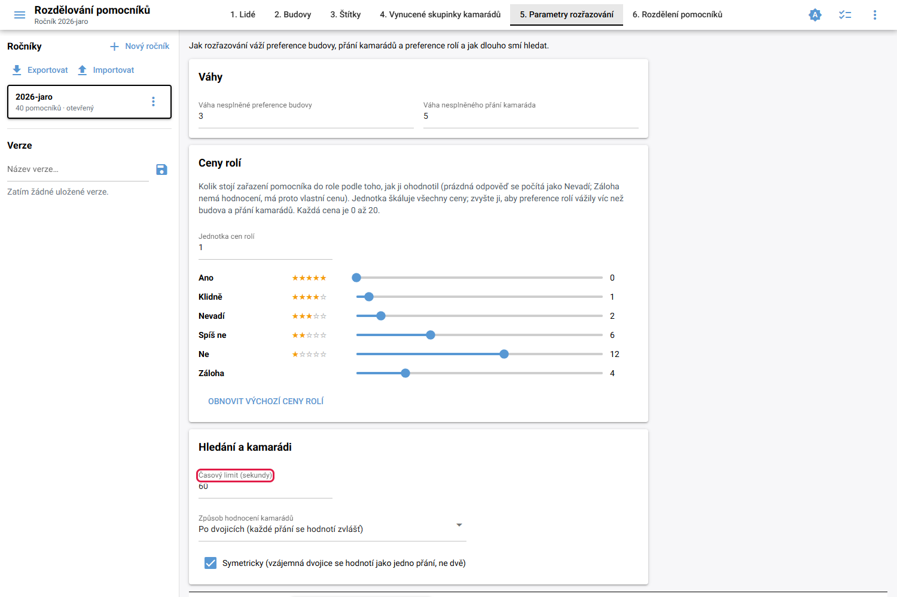

Mezi váhami je také **Váha porušeného měkkého pravidla**: kolik stojí každý
člověk, který poruší měkké pravidlo štítku nebo skupinky. Tvrdá pravidla váha
neovlivní, ta se ohýbají vždy až jako poslední.

Nahoře u časového limitu hledání jsou vidět sekundy. Změny uložíš dole
tlačítkem **Uložit parametry**.

## 11. Krok 8: Sestav rozdělení

Na záložce **2. Budovy** klikni na **Uložit a sestavit rozdělení**. (Stejně
funguje tlačítko **Sestavit rozdělení** na záložce 6.)

Objeví se okno **Sestavuji rozdělení…**. Počítač hledá nejlepší rozdělení.
**Počkej**, trvá to nejvýš tolik, kolik je časový limit (obvykle méně než
minutu). Okno nejde zavřít, zavře se samo.

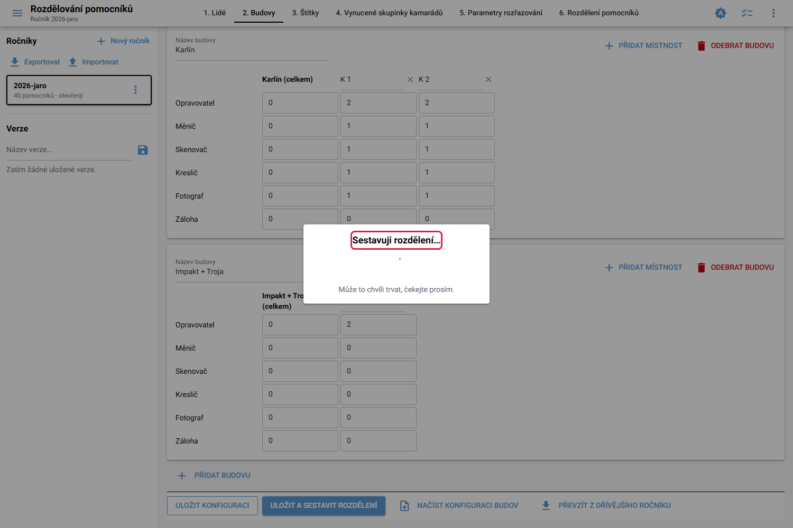

Když je hotovo, otevře se záložka **6. Rozdělení pomocníků**.

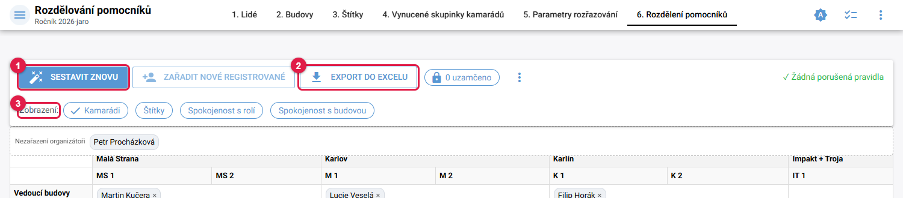

1. **Sestavit znovu** — spustí výpočet znovu.
2. **Export do Excelu** — uloží hotovou tabulku. Funguje, až je každý zařazen
   a rozdělení je aktuální.
3. **Zobrazení** — zapínání barevných pomůcek (viz [krok 9](#12-krok-9-uprav-rozdělení-ručně)).

Vpravo je buď zelené **✓ Žádná porušená pravidla**, nebo červené tlačítko
s počtem **porušených pravidel**. Na to se podívej vždy — ukáže, co se
nepodařilo splnit (například chybí lidé v místnosti nebo je někdo mimo místa
povolená jeho štítkem).

### Jak se čte tabulka

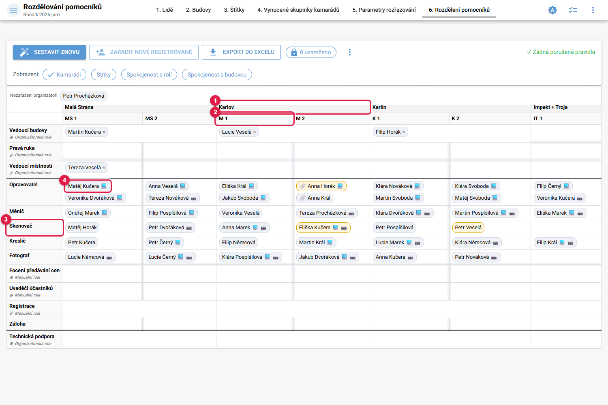

1. **Budova**.
2. **Místnost**.
3. **Role** (řádek). Nahoře jsou řádky pro organizátory (ty z tabulky budov
   už jsou na svých místech), pod nimi řádky pro pomocníky: Opravovatel, Měnič,
   Skenovač, Kreslič, Fotograf a Záloha.
4. **Pomocník** — každé jméno je „kartička“. Ikona 💻 značí, že může přinést
   notebook, 📷 fotoaparát.

Oranžový rámeček kolem kartičky znamená, že pomocníkovo přání být s kamarádem
se nesplnilo.

## 12. Krok 9: Uprav rozdělení ručně

Výsledek je návrh. Cokoli v něm můžeš změnit **přetažením myší**. Nic se
nepíše klávesnicí — jména se přenášejí kartičkami.

### Přesunutí pomocníka

Pomocníci, kteří ještě nikde nejsou, čekají nahoře v oblasti **Nezařazení**.
Typicky je to někdo, koho jsi přidal(a) ručně po sestavení rozdělení.

Pozdního zájemce přidáš na záložce **1. Lidé** tlačítkem **Přidat** nad
tabulkou *Pomocníci*:

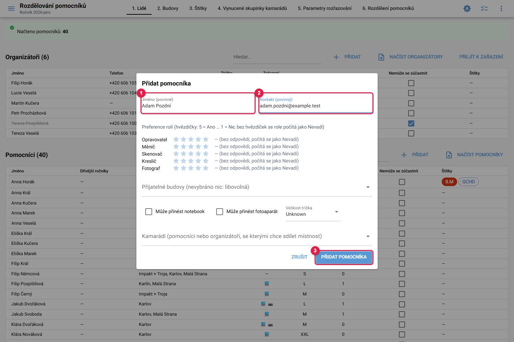

1. Jméno.
2. Kontakt (e-mail nebo telefon).
3. **Přidat pomocníka**.

Po návratu na záložku **6** vidíš upozornění, že někdo není zařazen.
Máš dvě možnosti:

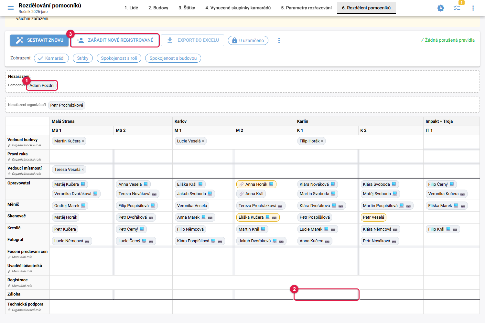

1. Kartička v oblasti **Nezařazení**. Chyť ji myší…
2. …a **pusť ji na buňku**, kam patří (správná místnost a role).
3. Nebo klikni na **Zařadit nové registrované** — počítač nové lidi
   zařadí sám a **všichni ostatní zůstanou přesně na místě**.

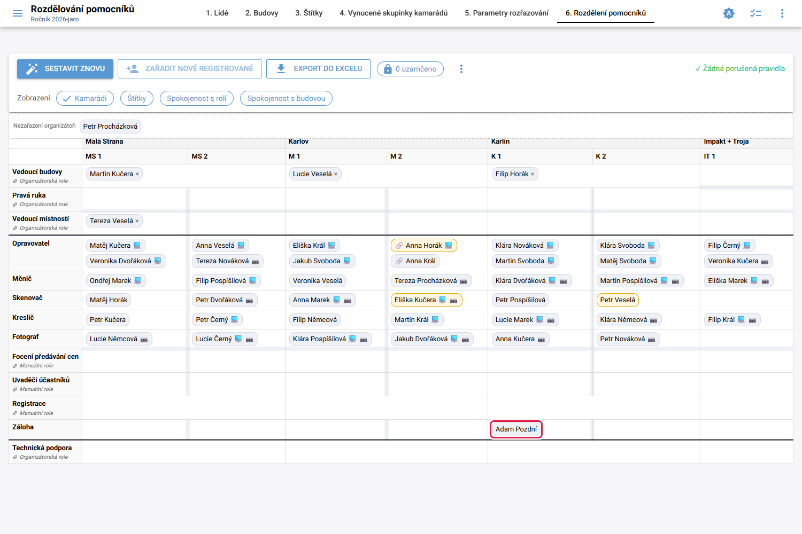

Takhle přesouvat můžeš kohokoli — i z jedné buňky do druhé.

### Podrobnosti o pomocníkovi a zámek

Klikni na kartičku. Otevře se **karta** s přáními pomocníka.

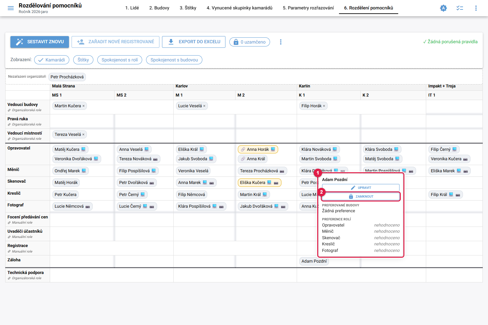

1. Karta ukazuje preferované budovy a hodnocení rolí.
2. **Zamknout** — zamčený pomocník **zůstane na svém místě**, i když pustíš
   **Sestavit znovu**. Zamčené poznáš podle 🔒. Odemkne ho totéž tlačítko.

Kartu zavřeš klávesou **Esc** nebo kliknutím mimo ni. Podržíš-li při
kliknutí na kartičku **Ctrl**, zamkne se přímo.

> Pozor: **Sestavit znovu** přeskládá všechny, kdo nejsou zamčení. Aplikace
> se předem zeptá („Nahradit neuzamčená přiřazení?“). Chceš-li si ruční
> úpravy ponechat, zamkni je. V nabídce ⋮ vedle tlačítek je
> **Uzamknout všechny zařazené**.

### Barevné pomůcky (Zobrazení)

Pod tlačítky jsou přepínače **Zobrazení**. Obarví kartičky podle toho,
jak jsou pomocníci spokojení.

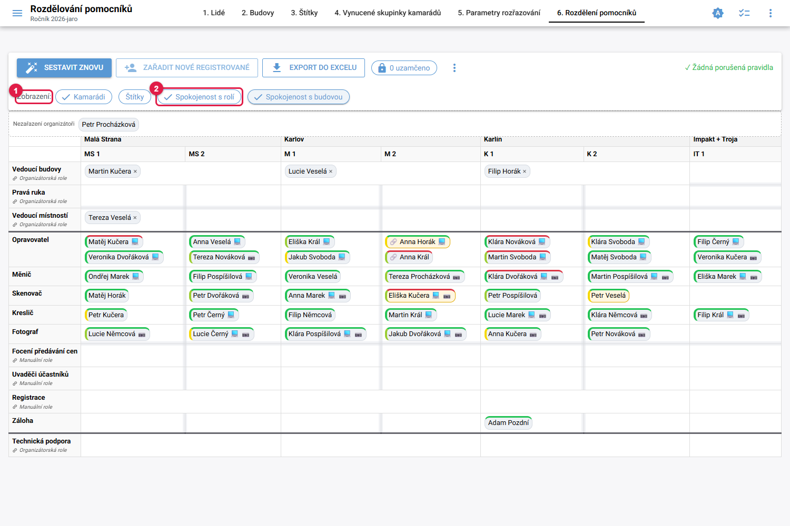

1. Nápis **Zobrazení**.
2. Přepínače:
   - **Kamarádi** — zvýrazní přání být s kamarádem (po najetí myší na
     kartičku se ukážou i kamarádi).
   - **Štítky** — pruhy podle štítků; umožní i **Filtrovat podle štítků**.
   - **Spokojenost s rolí** — svislý okraj vlevo: **zelený** = role mu vyhovuje,
     **červený** = spíš ne.
   - **Spokojenost s budovou** — vodorovný okraj nahoře: **zelený** = je v budově,
     kterou si přál, **červený** = není.

### Organizátoři

Organizátoři, které jsi nezařadil(a) tabulkou budov, čekají v oblasti
**Nezařazení organizátoři**. Přetáhni je na řádky **Vedoucí budovy**,
**Pravá ruka**, **Vedoucí místností** nebo **Technická podpora**. Jinam
(do řádků pomocníků) nejdou.

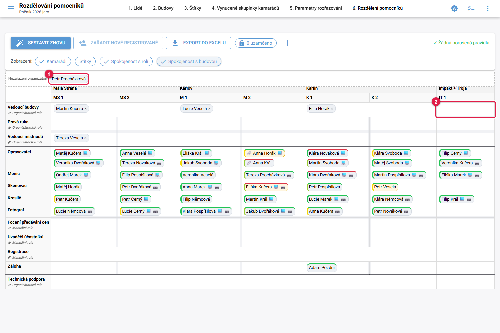

1. Organizátor v oblasti **Nezařazení organizátoři**.
2. Buňka, na kterou ho pustíš (zde Vedoucí budovy u budovy Impakt + Troja,
   kterou jsme přidali ručně a tabulka ji neznala).

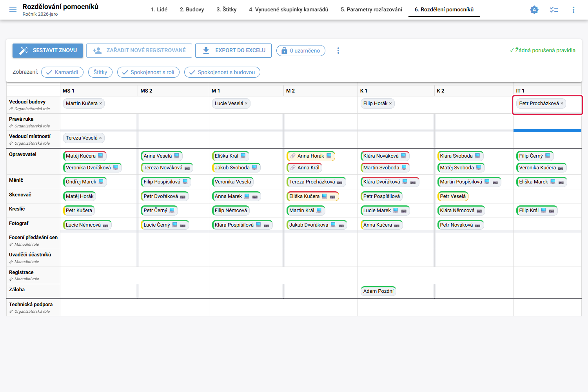

Z buňky ho odebereš **křížkem ×** vedle jména. Do buňky lze dát i víc lidí.

Řádky **Focení předávání cen**, **Uvaděči účastníků** a **Registrace** se
vyplňují jinak: přetáhni na ně kartičku pomocníka z jeho místnosti.
Pomocník tím **zůstane na svém místě** a navíc se objeví i tady (s tečkovaným
okrajem). Registrace platí pro celou budovu, ostatní dvě pro konkrétní místnost.

## 13. Krok 10: Ulož verzi a exportuj do Excelu

### Verze

Před větším zásahem si můžeš stav **uložit jako verzi** a později se k němu
vrátit. V postranním panelu napiš název do pole **Název verze…** a stiskni
Enter (nebo klikni na disketu).

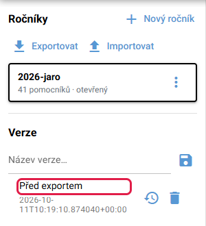

Uložená verze je v rámečku. Vpravo jsou dvě tlačítka: **Obnovit** (vrátí vše
do stavu té verze) a **Smazat**.

### Export

Až je rozdělení hotové, klikni na **Export do Excelu**.

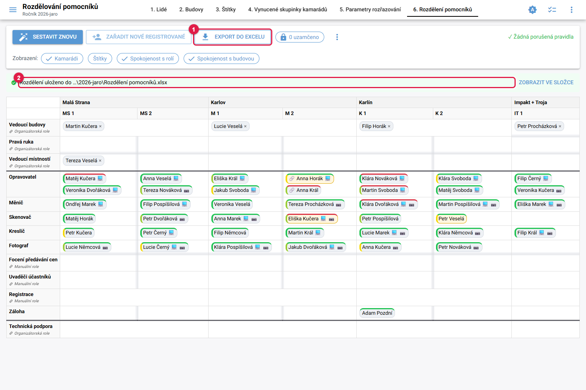

1. Tlačítko **Export do Excelu**.
2. Zelená zpráva ukáže, **kam se soubor uložil** — do složky tohoto ročníku.
   Vpravo je tlačítko **Zobrazit ve složce**, které složku otevře.

Při dalším exportu se starý soubor **přepíše**. Chceš-li si ho uschovat,
přejmenuj ho nebo zkopíruj jinam. Pokud je soubor otevřený v Excelu,
export nepůjde — zavři ho.

## 14. Když něco nejde

**Program se nespustí nebo ho systém zablokuje.**
Projdi si [potíže se spuštěním](#potíže-se-spuštěním--udělej-to-hned): odblokování
na Windows a dva příkazy na macOS.

**Aplikace se v prohlížeči chová divně nebo nereaguje na kliknutí.**
Otevři ji v Chrome, Edge nebo Firefoxu. V Safari nefunguje správně.

**Tlačítko Export do Excelu je šedé.**
Najeď na ně myší, napíše důvod. Obvykle jde o jedno z těchto:

- *Rozdělení pomocníků je neaktuální.* Něco jsi změnil(a) (například někomu
  zaškrtl(a) *Nemůže se zúčastnit* nebo upravil(a) skupinku). Klikni na **Sestavit znovu**.
- *Zatím nezařazení zájemci.* Někdo nemá místo. Přetáhni ho do tabulky
  nebo klikni na **Zařadit nové registrované**.
- Ještě jsi nic nesestavil(a) — udělej [krok 8](#11-krok-8-sestav-rozdělení).

**Červené tlačítko „porušená pravidla“.**
Klikni na něj. Každý řádek říká, co se nepodařilo splnit, a tlačítko
**Opravit** tě zavede tam, kde to jde napravit. Typicky se do místnosti
nedostal dost lidí, nebo někdo porušuje pravidlo štítku či skupinky.

**Sestavení hlásí, že nenašlo rozdělení.**
Zkus prodloužit časový limit na záložce **5. Parametry rozřazování**.
Zkontroluj také, že počty lidí v budovách na záložce **2** nejsou vyšší,
než kolik máš pomocníků.

**Tabulka budov se nenačte nebo v ní něco chybí.**
Zkontroluj, že je soubor `.xlsx`, že má nad řádky rolí dva řádky záhlaví
(budovy a místnosti) a že je potřebný pomocník označen **barvou** buňky
(šedá a bílá se nepočítá). Vedoucí musí být nahraní mezi organizátory, jinak
se ozve panel **K vyřízení**.

**Nahrál jsem špatný soubor / chci začít znovu.**
Vpravo nahoře je nabídka ⋮ s položkou **Začít znovu**. Otevřený ročník se
vyprázdní. Uložené verze zůstanou. Předtím můžeš ročník vyexportovat
(v postranním panelu **Exportovat**) a mít jeho zálohu v souboru `.zip`.

**Aplikace přestala reagovat.**
Zavři prohlížeč i okno programu, spusť program znovu (`rostering.exe` nebo
`./rostering`) a otevři <http://127.0.0.1:8000>. Data se ukládají sama,
nic neztratíš.

**Chci přenést data na jiný počítač.**
V postranním panelu u **Ročníky** klikni na **Exportovat**, na druhém počítači
na **Importovat**.

---

## Pro vývojáře: jak se obrázky vytvářejí

Obrázky v `img/` vzniknou skriptem
[`tools/make_screenshots.py`](tools/make_screenshots.py). Skript spustí aplikaci
nad vymyšlenými daty z `tests/survey_factory.py` (do dočasné složky, skutečná
`data/` se nedotkne), proklikává ji přes Playwright a červené rámečky kreslí
těsně před každým snímkem. Tabulku budov, kterou skript nahrává, píše
[`tools/building_sheet_demo.py`](tools/building_sheet_demo.py); stejný modul
ji vykreslí i jako obrázek tabulky, protože Excel se řídit nedá. Po změně
vzhledu aplikace je stačí vygenerovat znovu:

```
pip install playwright          # do virtuálního prostředí projektu
python docs/manual/tools/make_screenshots.py
```

Skript používá prohlížeč Microsoft Edge (`PLAYWRIGHT_CHANNEL` lze změnit na
`chrome` nebo `chromium`).
